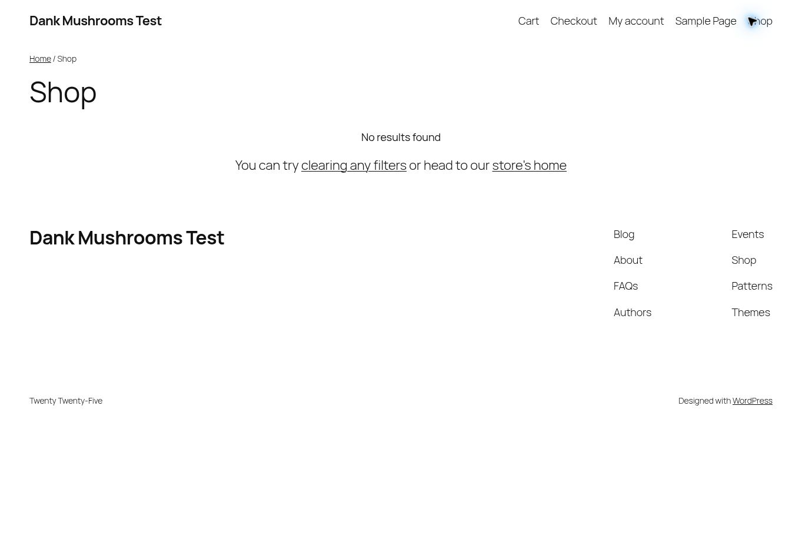

# Test2 commerce acceptance checkpoint — 2026-11-01

This is new evidence from `23.92.26.193`, not evidence inherited from the deleted
Linode. RootedOps source on the host is merged main
`1dc9e26464c5e9fddf46b6fb64f065e58a26b78a` (PR #45).
No restore/rebuild, restored database migration, SignatureGate application/schema/
role change, Appsmith datasource query, production change or live payment occurred.

## Results and scope

| Gate | Actual result |
| --- | --- |
| DNS | Both Cloudflare authorities directly answer A `23.92.26.193` for ERP/Appsmith/n8n/shop `-test2`; no AAAA answers |
| TLS | Certificate `commerce-staging-test2`, four matching SANs, expiry 2027-01-30; trusted HTTPS to each name verified |
| Renewal | `certbot renew --cert-name commerce-staging-test2 --dry-run --run-deploy-hooks` passed; NGINX test/reload deploy hook passed |
| Browser | Homepage and `/shop/` load successfully over HTTPS; shop is intentionally empty because fixtures remain drafts |
| Access gates | ERP/Appsmith/n8n roots 403; unauthenticated Woo REST 401; shop XML-RPC and HTTP cron 403 |
| Native Woo catalog | Simple product 10, variable parent 11, variations 13/14; repeated upserts preserve IDs; stock drift corrected; ownership refusal passed |
| Metadata | Price 12.50 USD, category, tax-none fixture, descriptions and SEO metadata checked; this does not validate reviewed real tax mappings |
| Native media | Synthetic 24×24 PNG uploaded as media 15 and attached by ID; SHA256 `1e98c98de5355e3d0fb16728f4da45471bfc4eeac2ef7db6a1aaa6476ac4a4a4` |
| SEO hooks | Installed native core/Yoast-compatible hooks passed; Yoast is not installed; no rendered product-page SEO acceptance claimed |
| Isolation | Four inspected application containers retain sole internal networks and no published service ports; 84 n8n workflows, zero active |
| WordPress outbound | Cron disabled, HTTP blocked, mail short-circuited, zero available payment gateways |
| Native ERP | Six apps installed, commerce 0.3.0 import works; maintenance mode and scheduler pause remain 1; outgoing email/webhooks/notifications zero |
| Restored MP | Catalog snapshot, commerce ingest, reservation confirmation and product acknowledgement functions are absent; ledger integration is not ready |

The mail sink deliberately short-circuits `wp_mail` with `pre_wp_mail` returning
true. An initial verification incorrectly expected false and failed; correction
verified the installed hook and its short-circuit return. No mail configuration
change was necessary, and the probe used only `fixture@example.invalid`.



## Image and application identities

Inspected WordPress image ID and repository digest:
`wordpress@sha256:12ec50e21cb81a5ea964669d434578b7da4a101a45aef83f5f1c2227bcd1b058`.
ERP custom image ID and repository digest:
`rootedops-erpnext@sha256:908a38651afd93e0e2823cfee7ce4c07db02293c072f6c006d2ea26c311d3438`.
The private receipt also records Appsmith/n8n identities and networks.

Native ERP versions: Frappe 16.14.0, ERPNext 16.13.0, HRMS 16.4.7,
Employee Self Service 2.2.2, rootedops_payroll 0.4.10, rootedops_commerce 0.3.0.
Before the candidate fixture below, read-only counts: Item/Item Price/Customer/Sales Order/Sales Invoice/Payment Entry
all zero, Contact 9, Address 5. These are not migrated Ecwid records.
WordPress 7.1.4 / WooCommerce 11.2.1 retain the previously verified installation;
this checkpoint uses that existing shop, not a second installation.

## Reproduce the successful native tests

Run from `/home/rootedops/RootedOps`, after reviewing source and private overrides:

```bash
~/bin/test2-console-lock commerce
sudo -v
sudo python3 scripts/commerce_staging_ingress.py .test-deployment
sudo python3 scripts/commerce_staging_ingress.py .test-deployment --apply --browser-shop
sudo python3 scripts/commerce_woo_native_smoke.py .test-deployment
sudo python3 scripts/commerce_woo_media_smoke.py .test-deployment
sudo certbot renew --cert-name commerce-staging-test2 --dry-run --run-deploy-hooks
sudo nginx -t
exit # release the locking shell
```

The ingress refresh requires existing certificate/verified TLS and installation
receipts. Native harnesses use generated matching receipt/environment hostnames;
keep `.test-deployment/private/wordpress-offline.yml` in every shop Compose command.
ERP commands still require the private restored-image override documented in
[test2-shared-readiness.md](test2-shared-readiness.md).

The installed NGINX site is `/etc/nginx/sites-available/commerce-staging-closed.conf`.
HTTP serves only `/var/www/rootedops-acme` challenges; other HTTP paths are closed.
The renewal deploy hook is `/etc/letsencrypt/renewal-hooks/deploy/rootedops-test2-nginx`
and runs `nginx -t` then `systemctl reload nginx`. Service/container recreation
requires re-running the guarded ingress refresh to resolve its current private IP.
No Docker network was made external to obtain certificate or browser access.

Private evidence under `.test-deployment/` (do not commit credentials or raw data):

- `tls-acceptance.json`, `shop-upstream-receipt.json`.
- `private/woo-native-smoke.json`, `private/woo-native-media-seo.json`.
- `private/test2-commerce-https-acceptance.json` (HTTP outcomes, image digests,
  internal networks, workflow counts and actual outbound-control verification).
- `private/test2-erp-readonly-health.json`, `private/test2-mp-interface-health.json`.
- `private/nginx-before-test2-tls.conf`, plus `nginx-staging.previous.conf`.

## CI and remaining work

RootedOps #45 final head `b57dada70c1f4f3baace3aa1d2fc5db8dd12c69f`:
[foundation](https://github.com/RayzorDuff/RootedOps/actions/runs/41268253047),
[recovery](https://github.com/RayzorDuff/RootedOps/actions/runs/41268253051), and
[disposable integration contracts](https://github.com/RayzorDuff/RootedOps/actions/runs/41268253091)
all passed. Current main rerun: 83 commerce tests, 82 passed/one PHP-dependent skip.
MushroomProcess #111 final head `a7e6a12052f050c674969f760c42272c163019ec`:
[PostgreSQL rebuild/contracts](https://github.com/RayzorDuff/MushroomProcess/actions/runs/41268312652)
and [lint](https://github.com/RayzorDuff/MushroomProcess/actions/runs/41268312605) passed.
Current MushroomProcess main is `451393c621b64c5bd4ca7d03b1525c6253f641ae`;
these repository commits do not establish its restored DB migration level.

The old `native-inventory.json` and `erp-test-catalogs.json` snapshots are absent
on Test2. Do not recreate them from the deleted host or imply the native draft
fixture harness demonstrates ERP/MP authority or full catalog parity. The older
snapshot harness also retained hardcoded `-test` targets; the accompanying code
change routes it through the same receipt/environment validation as the other
native harnesses. It has not run against Test2 snapshots.

Next development gates:

1. Build a disposable synthetic MP database from current main migrations; preserve
   the restored operational database. Verify database identity and current ledger
   migrations before connecting the inbox worker. Its restored DB name is refused
   by existing runtime guards; do not weaken the guard or rename a restored DB.
2. Establish reviewed ERP Item/Price/content and exact SKU/variant/tax/category
   mappings; create new Test2 inventory/catalog snapshots from authoritative data.
3. Demonstrate a real isolated Woo REST order through authenticated raw-body
   ingestion and durable inbox, then reservations, partial shipment acknowledgement,
   cancellation/refund/reconciliation and ERP source identities. Do not replay real
   Ecwid production orders or assert physical shipment from payment status.
4. Verify actual Ecwid product/customer/historical-order migration parity, media
   and rendered product SEO, rather than only synthetic draft fixtures.
5. Obtain approved Clover sandbox configuration and test payment identity and
   reconciliation. No live processing or merchant setting changes are authorized.

Rollback: refresh ingress without `--browser-shop` to close browser/media access;
retain ACME renewal and authenticated API-only routes. For a complete ingress
rollback, inspect the saved prior NGINX file, restore only this staging vhost,
validate and reload. Do not rerun recovery or drop any restored/shared databases.
Synthetic fixtures can remain drafts for repeatability; do not delete unrelated
products/media. Ecwid retirement remains **no-go** until the above gates and the
staging handoff's cutover checklist pass. SignatureGate browser E2E remains its
separate workstream.

## Native ERP priced-catalog preview and defect found

The initial native fixture (`c363a699efd160ba5fe424208d8525d1404f7802`)
reproduced `Item Price MandatoryError: price_list_rate` against installed commerce
0.3.0. Its transaction rolled back. The importer incorrectly used the integration
field `item_price_rate` as a native ERPNext field. PR
[#47](https://github.com/RayzorDuff/RootedOps/pull/47), commit
`198a207b0a3f34c918552a88cca37ffc355af8c6`, corrects native reads/writes to
`price_list_rate`, preserves `item_price_rate` in the API contract and bumps the
app to 0.3.1. Its new priced-import/retry/catalog/drift native Frappe regression
passed [disposable CI](https://github.com/RayzorDuff/RootedOps/actions/runs/41321093029);
foundation/recovery passed too.

A hash-verified candidate service-layer preview then passed against Test2's native
ERP database and real authenticated Woo REST. This does **not** replace the
installed app or validate its HTTP authentication/upgrade. No container restart,
shared volume overwrite or ERP configuration change was made. The helper invokes
the candidate API in a short-lived native Frappe process, checks permissions and
commits only the uniquely identified synthetic catalog fixture.

Successful harness source: `73080f4db893696a3021b842c9fb0f0b3aaa6181`, branch
`feature/commerce-test2-validation`. Candidate API SHA256:
`c6b348c56641aeba47d17cd1866a1ae65f204c6bcf3b91a3bbb70eb5f78ea91b`.

- SKU `SYN-TEST2-ERP-CATALOG`: one ERP Item, one Item Price, one Commercial Product
  Content and one channel mapping. Synthetic Item Group/Price List are dedicated.
- Woo draft product ID 16 preserves its ID across reruns; description, SEO metadata,
  category, tax-none fixture and USD 12.50 price match the ERP projection.
- Woo returns this price as `12.5`; an initial harness assertion overconstrained
  string formatting. The corrected assertion compares exact Decimal values.
- Canonical ERP content stays Draft; mapping sync stays disabled. Publication
  approval and quantity 2 are in-memory fixtures. MP inventory and HTTP ERP auth
  are not covered, and no Customer/sales/accounting document is created.
- Private evidence: `erp-native-catalog-fixture.json` and
  `erp-woo-native-fixture-report.json`. These new synthetic records intentionally
  change ERP catalog counts from the earlier zero baseline, not historical data.

Existing isolated source worktrees on Test2 contain those exact tested commits:

```bash
~/bin/test2-console-lock commerce
sudo -v
sudo python3 /home/rootedops/RootedOps-commerce-validation/scripts/commerce_erp_native_fixture.py \
  /home/rootedops/RootedOps/.test-deployment \
  --candidate-api /home/rootedops/RootedOps-item-price-candidate/erpnext/apps/rootedops_commerce/rootedops_commerce/api.py \
  --candidate-api-sha256 c6b348c56641aeba47d17cd1866a1ae65f204c6bcf3b91a3bbb70eb5f78ea91b
exit
```

Acquire the console lock before any Lish operation. If unavailable, do repository
work instead; never delete its file, bypass flock or take over SignatureGate's
Screen session. Exit the locking shell promptly when server operations finish.
The lock does not authorize changes to shared infrastructure or other databases.

Before claiming installed ERP acceptance, review/deploy 0.3.1 with version/hash
and rollback evidence, then run the helper **without** the candidate flag.
The restored apps volume masks image application files, and the current initializer
copies commerce only if absent. An image switch alone therefore does not establish
an app upgrade: use an explicitly reviewed app-volume update and preserve its
prior source. Do not rerun a restore, reinstall the site or overwrite all apps.
The missing MP ledger migration/test database and complete order lifecycle remain
separate unresolved gates.
